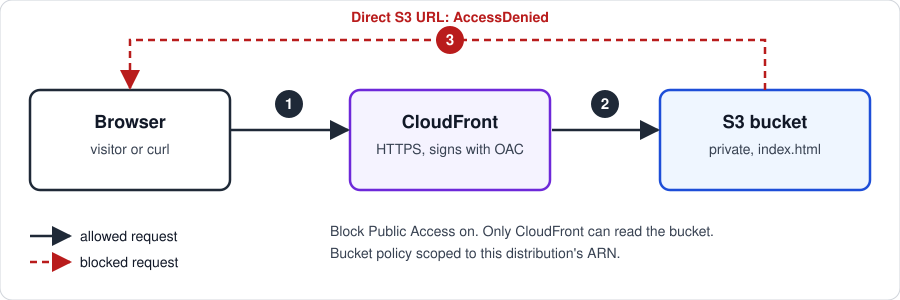

# Project 1: Static Website on S3 + CloudFront (Private with OAC)

A static HTML site hosted in a **private** S3 bucket and served globally through CloudFront. The bucket is not public. Only the CloudFront distribution can read from it, using Origin Access Control (OAC).

**Live URL:** https://d3pcoutm9zsags.cloudfront.net *(torn down after verification; see Teardown)*

## Architecture

CloudFront is the only thing allowed to read the bucket. It signs each request with Origin Access Control, and a direct request to the S3 URL returns `AccessDenied`.

## What I built

1. **S3 bucket** (`bobby-static-site-2026`, us-east-1): Block Public Access on all four settings, versioning enabled, default SSE-S3 encryption.
2. **Content:** a single `index.html` uploaded to the bucket root.
3. **CloudFront distribution:** S3 REST endpoint origin (not the website endpoint), OAC attached, HTTP redirected to HTTPS, default root object set to `index.html`.
4. **Bucket policy:** generated by CloudFront. It allows only `s3:GetObject`, only for the `cloudfront.amazonaws.com` service principal, and only when `AWS:SourceArn` matches this distribution's ARN.

## Verification

| Request | Expected | Result |
|---|---|---|
| `https://d3pcoutm9zsags.cloudfront.net/` | 200, page renders | Page renders ("Hello from S3 + CloudFront") |
| S3 object URL directly | `AccessDenied` | `AccessDenied` XML error |

## Issues I hit and how I fixed them

- **`AccessDenied` at the CloudFront URL.** The bucket policy and OAC were correct, but the distribution's **Default root object** was blank. A request for `/` asked S3 for an empty key. Because the policy grants only `s3:GetObject` and not `s3:ListBucket`, S3 returned `AccessDenied` for a key that doesn't exist, instead of `NoSuchKey`. Setting the default root object to `index.html` fixed it.

## What I'd do differently or next

- Add a custom domain with ACM and Route 53.
- Put the bucket and distribution in IaC (Terraform or CloudFormation) so the setup is reproducible.
- Add a CloudFront access log or a CloudWatch alarm on 4xx/5xx rates.

## Teardown

Resources are deleted in this order to avoid charges:

1. Disable, then delete the CloudFront distribution.
2. Empty the bucket, including all object versions (**Show versions** on).
3. Delete the bucket.
4. Delete the Origin Access Control.

## Cost

Roughly $0 for the test window: the resources were removed after verification.
