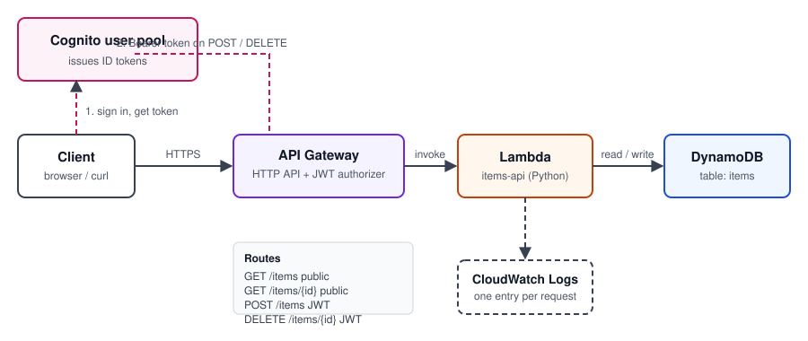

# Project 2: Serverless REST API (API Gateway + Lambda + DynamoDB + Cognito)

A REST API for a simple items list. API Gateway receives requests, a Lambda function runs the logic, DynamoDB stores the data, and Cognito protects the write routes.

**Status:** Deployed and verified. Public reads, 401 checks, and the authenticated create and delete all pass. Torn down: yes, all resources deleted.

## Architecture



The client signs in with Cognito to get a token. API Gateway checks that token on the write routes, then invokes a Lambda function. The function reads and writes a DynamoDB table and logs each request to CloudWatch.

## Routes

| Method | Path | Auth | Purpose |
|---|---|---|---|
| GET | `/items` | Public | List all items |
| GET | `/items/{id}` | Public | Get one item |
| POST | `/items` | Cognito JWT | Create an item |
| DELETE | `/items/{id}` | Cognito JWT | Delete an item |

## Build steps (AWS console)

Use **us-east-1** for the whole project.

1. **DynamoDB:** Create table `items`, partition key `id` (String). Use on-demand capacity.
2. **Cognito:** Create a user pool with email sign-in. Use the **Single-page application** app type, which creates a public client with no secret. Enable the **Username and password (USER_PASSWORD_AUTH)** flow on the app client. Create one test user with a verified email and a permanent password.
3. **Lambda:** Create function `items-api`, runtime **Python 3.12**. Paste `lambda/handler.py` into the code editor and deploy. Under **Configuration → Environment variables**, add `TABLE_NAME = items`.
   - **Handler:** The console creates `lambda_function.py` with a default handler. Put the code in `lambda_function.py`, and set **Runtime settings → Handler** to `lambda_function.handler`. A mismatch here causes `Runtime.HandlerNotFound` on every request.
4. **Lambda permissions:** On the execution role, add an inline policy that allows `dynamodb:Scan`, `GetItem`, `PutItem`, and `DeleteItem` on the `items` table ARN only.
5. **API Gateway:** Create an **HTTP API** named `items-api`. Add the four routes above. Attach the Lambda as the integration for each one. Using one shared integration is cleaner than creating one per route.
6. **Authorizer:** Create a JWT authorizer named `cognito-jwt`:
   - **Issuer URL:** `https://cognito-idp.us-east-1.amazonaws.com/<user-pool-id>`
   - **Audience:** the app client ID
   - **Identity source:** `$request.header.Authorization`

   Attach it to the POST and DELETE routes only.
7. **Deploy:** Create the `$default` stage with auto-deploy on. Copy the invoke URL.

## Verification

Replace `API_URL` with your invoke URL.

```bash
# Public: should return []
curl -s API_URL/items

# Protected: without a token, expect 401
curl -s -o /dev/null -w "%{http_code}\n" -X POST API_URL/items -H "Content-Type: application/json" -d '{"name":"test"}'
curl -s -o /dev/null -w "%{http_code}\n" -X DELETE API_URL/items/abc

# Protected: with a token, expect 201 and an id
curl -i -X POST API_URL/items -H "Authorization: Bearer TOKEN" -H "Content-Type: application/json" -d '{"name":"first item"}'
```

Get `TOKEN` from the Cognito `InitiateAuth` endpoint with `USER_PASSWORD_AUTH`. Use the **ID token**, not the access token, because the authorizer checks the `aud` claim.

**Checkpoints:**
- `GET /items` returns `200` and `[]`. **Verified.**
- The unauthenticated POST and DELETE return `401`. **Verified.**
- The authenticated POST returns `201`, and the item shows up in a GET. **Verified.**
- The authenticated DELETE returns `204`, and the GET returns `[]` again. **Verified.**
- The Lambda's log group shows one invocation per request.

## Issues I hit and how I fixed them

- **`Runtime.HandlerNotFound: Handler 'lambda_handler'`.** The console default handler didn't match the code. Fixed by setting the handler to `lambda_function.handler`.
- **Route missing after cleanup.** Deleting the extra integrations removed the `GET /items` route's integration, and the route then returned `404`. Recreated the route and attached the shared integration.
- **Test user stuck on a temporary password.** Console-created users must change their password at first sign-in. The sign-in call returns a `NEW_PASSWORD_REQUIRED` challenge, which has to be answered with `RespondToAuthChallenge` before any token is issued.
- **Blocked integration delete.** An integration can't be deleted while a route uses it. Each route has to point at the shared integration first.

## Teardown

1. Delete the API Gateway HTTP API.
2. Delete the Lambda function and its execution role.
3. Delete the Cognito user pool.
4. Delete the DynamoDB table.
5. Confirm the CloudWatch log group `/aws/lambda/items-api` is deleted or set to a short retention.

## Concepts practiced

- Serverless compute and event-driven invocation (Lambda)
- Managed NoSQL with a partition key (DynamoDB)
- JWT authorization with a managed identity provider (Cognito + API Gateway)
- Least-privilege IAM for a single table
- Diagnosing a failed invocation with CloudWatch logs
