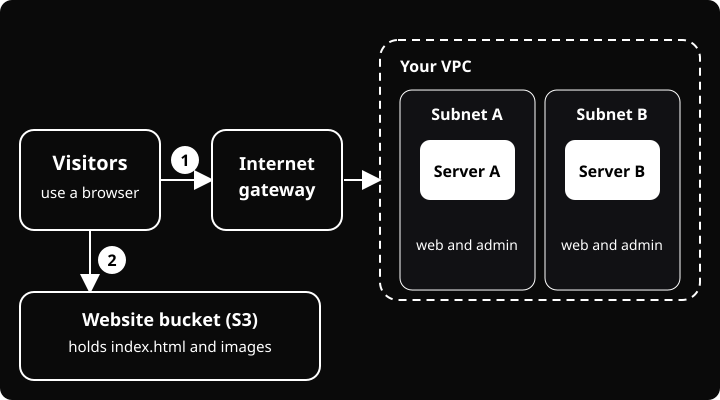

# Project 3: AWS Cloud Infrastructure

A segmented AWS network where each server accepts only the traffic and identities it needs. Two public subnets sit in separate Availability Zones, each with its own route table and a web server, plus a static website served from S3.

**Status:** Built and checked. Torn down: yes, all resources deleted.

## Architecture

Visitors' requests enter through the internet gateway and reach a server in one of two subnets. The security group decides what each server accepts. The website is served separately from S3.

## Decisions

- **Two Availability Zones.** If one zone has an outage, the other subnet and its server keep running.
- **A route table per subnet.** A subnet is public only when its route table sends `0.0.0.0/0` to the internet gateway.
- **One security group per job.** Admin SSH is open only from one IP address. Web traffic is HTTP on port 80. The internal group allows all TCP traffic between the two servers.
- **Access by role.** The developer policy allows EC2 actions only on instances tagged `Env=development`, and an explicit deny blocks tag changes.
- **Systems Manager for administration.** The servers' role lets Systems Manager manage them without an open SSH port.
- **Website in S3.** The bucket allows public reads of the site files only, through `s3:GetObject`.

## Checks

- SSH works from the admin IP address and is refused from elsewhere.
- The website loads from the bucket's website endpoint, and anonymous uploads are refused.
- The two servers can reach each other through the internal security group.
- A developer user can see and stop instances tagged `Env=development`, and can't change tags.

## Issues I hit and how I fixed them

- **SSH refused the key with UNPROTECTED PRIVATE KEY FILE.** Other users on the computer could read the key file. Fix: `chmod 400` on the key.
- **SSH stopped working.** The admin IP address had changed, so the admin rule no longer matched. Fix: updated the rule to the current address, and used Systems Manager when possible.
- **A server couldn't install updates.** Its subnet's route table had no `0.0.0.0/0` route to the internet gateway. Fix: added the route and checked the subnet association.
- **The website returned 403 Forbidden.** The bucket policy was missing, or a Block Public Access setting still blocked it. Fix: reviewed the policy and the four settings.
- **A developer got "not authorized" errors.** The instance was missing the `Env=development` tag, so the developer policy didn't apply. Fix: added the tag.

## Teardown

1. Terminate both EC2 instances.
2. Delete the VPC's subnets, route tables, internet gateway, and security groups.
3. Empty and delete the website bucket.
4. Delete the IAM developer user, group, and policy.

## Next

- Define the network and servers in infrastructure as code so the environment can be rebuilt on demand.
- Set a billing alarm, so leftover resources are caught early.

## Concepts practiced

- VPC design across Availability Zones
- Public and private routing with route tables and an internet gateway
- Security groups as per-server firewalls
- Tag-based IAM access control
- Static website hosting on S3 with controlled public access
