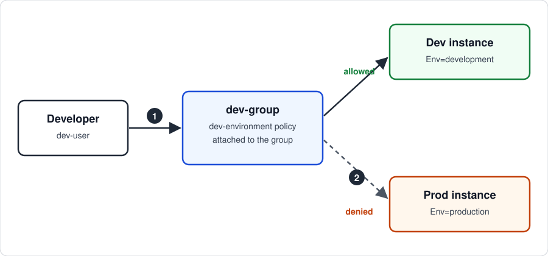

# Project 3: AWS IAM Access Control

Tag-based IAM access control. A developer can stop development EC2 instances but cannot touch production ones. The rule is set by the `Env` tag, and a separate user login confirms it works.

**Status:** Built and tested. Development instance can be stopped by the developer. Production instance is refused. Torn down: yes, all resources deleted.

## Architecture

The developer's IAM user belongs to `dev-group`, which holds the policy. The policy's condition matches the `Env` tag on each instance. The development instance matches and is reachable. The production instance does not match, so the same actions are refused.

## Policy

[`policies/dev-environment-policy.json`](policies/dev-environment-policy.json) has three statements:

- **Allow `ec2:*`** on resources tagged `Env=development`.
- **Allow `ec2:Describe*`** on all resources, so the developer can see what is running.
- **Deny `ec2:CreateTags` and `ec2:DeleteTags`** on all resources, so a tag can't be changed to get around the rule.

## Build steps (AWS console)

Use the same Region for the whole project.

1. **EC2:** Launch two instances. Name one `prod` with tag `Env = production`, and one `dev` with tag `Env = development`. Keep the free-tier AMI and instance type. For a lab, proceed without a key pair. Skip the network and storage settings.
2. **IAM policy:** Go to **IAM → Policies → Create policy**, switch to the JSON editor, and paste `policies/dev-environment-policy.json`. Name it `DevEnvironmentPolicy`, then save.
3. **Account alias:** In the IAM dashboard, create an account alias. Check that the alias matches the one you will use in the sign-in URL (see Issues below).
4. **User group:** Create `dev-group` and attach `DevEnvironmentPolicy` to it.
5. **IAM user:** Create `dev-user` with console access. Add it to `dev-group`.
6. **Test:** Open the sign-in URL in an incognito window and log in as `dev-user`.

## Checks

Run as `dev-user`, in a separate incognito window:

| # | Action | Expected result |
|---|--------|-----------------|
| 1 | Stop the development instance | Succeeds |
| 2 | Stop the production instance | Refused with an authorization error |
| 3 | Add or remove a tag on any instance | Refused by the explicit deny |
| 4 | List instances in the console | Both instances are visible |

## Issues I hit and how I fixed them

- **The sign-in URL used an old account alias.** The group policy and the user were set up under a new alias, but the account still had an older alias, so the sign-in link did not match what I expected. Fix: check the current alias in the IAM dashboard before sharing the sign-in URL.

## Watch-outs

- **Untagged instances get no development access.** The condition checks the tag, so tag every instance when it is launched.
- **Skipping a key pair and the forced password change is for a lab only.** Real environments should use a key pair and require a password change on first sign-in.

## Teardown

1. Terminate both EC2 instances.
2. Remove `dev-user` from `dev-group`, then delete the user.
3. Delete `dev-group`.
4. Delete `DevEnvironmentPolicy`.
5. Delete the account alias.

## Next

- Turn on MFA for the admin account and for every IAM user.
- Test each new policy with the IAM Policy Simulator before attaching it to a group.

## Concepts practiced

- Tag-based access control (EC2 tags as an IAM condition)
- Least privilege with an explicit deny
- Access managed through IAM groups
- Testing permissions with a separate user login
