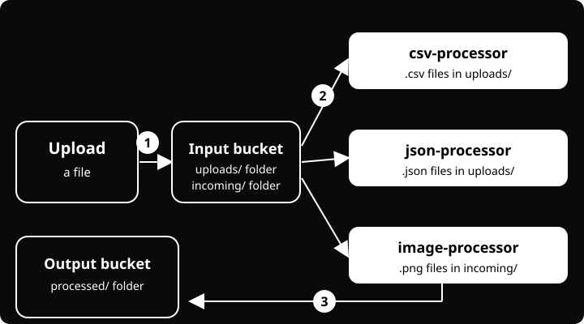

# Project 4: AWS Serverless Automation

A serverless file-routing workflow. Files dropped into an input bucket are sent to one of three Lambda functions based on their folder and file type. Each function writes its output to a separate bucket, and CloudWatch logs every run.

**Status:** Built, tested, and verified with five upload scenarios. Torn down: yes, all resources deleted.

## Architecture

A file lands in the input bucket. S3 checks its folder and file type, then calls the matching function. The function writes the result to the output bucket, and CloudWatch records the run.

## Decisions

- **Event notifications instead of polling.** S3 calls the function when a file arrives, so no compute runs while the bucket is idle.
- **Separate input and output buckets.** Results never land in the bucket that triggers the functions, so they can't start another run.
- **One notification per type.** Each rule matches one folder and file type, so every upload triggers exactly one function.
- **Least privilege.** Each function's role can read only its own input files and write only to the output folder.

## Function code

The three functions share the same handler in [`lambda/handler.py`](lambda/handler.py). It copies each file to the output bucket and is the starting point for real processing.

## Build steps (AWS console)

1. **Buckets:** Create an input bucket with `uploads/` and `incoming/` folders, and an output bucket with a `processed/` folder.
2. **Functions:** Create `csv-processor`, `json-processor`, and `image-processor`. Paste `lambda/handler.py` into each one, and set the handler to `lambda_function.lambda_handler`.
3. **Roles:** Give each function its own execution role. Allow `s3:GetObject` only on its input folder and `s3:PutObject` only on `processed/` in the output bucket.
4. **Event notifications:** On the input bucket, add one notification per function. Each one uses a unique prefix and suffix:
   - `uploads/` with suffix `.csv` → `csv-processor`
   - `uploads/` with suffix `.json` → `json-processor`
   - `incoming/` with suffix `.png` → `image-processor`

## Checks

| # | Upload | Expected result |
|---|--------|-----------------|
| 1 | A `.csv` to `uploads/` | `csv-processor` runs once and writes one file to `processed/` |
| 2 | A `.json` to `uploads/` | `json-processor` runs once |
| 3 | A `.png` to `incoming/` | `image-processor` runs once |
| 4 | A `.txt` file | No function runs |
| 5 | A file with spaces in its name | Processed correctly, because the key is URL-decoded |

## Issues I hit and how I fixed them

- **A function didn't run for an uppercase file extension.** The suffix match is case-sensitive, so `.CSV` doesn't match `.csv`. Fix: upload lowercase extensions, or add a rule for each capitalization.
- **A function ran over and over.** Its output was written to the folder that triggers it. Fix: write results only to the output bucket.
- **S3 refused to save a new event rule.** Two rules had the same prefix and suffix. Fix: give each rule a unique folder and file type.
- **The logs showed AccessDenied.** The role's policy named a different folder or bucket than the code used. Fix: compared the names in the policy with the names in the code.
- **Large files stopped partway through.** The timeout was too short. Fix: raised the timeout.

## Teardown

1. Delete the three event notifications on the input bucket.
2. Delete the three Lambda functions and their execution roles.
3. Empty and delete the input and output buckets.
4. Delete the CloudWatch log groups, or set a short retention.

## Next

- Replace the copy step with real processing for each file type, such as parsing CSV rows, reading JSON fields, or resizing images.
- Add a CloudWatch alarm on each function's Errors metric.

## Concepts practiced

- Event-driven compute with S3 notifications and Lambda
- Routing by prefix and suffix
- Least-privilege roles per function
- Diagnosing failed runs with CloudWatch logs
